# OutLab

**OutLab** (_Outdoor Lab_) is a local research workspace for biometric measurements taken outdoors. It puts EmotiBit sensor data, up to four Insta360 videos and a GPX route on one shared timeline. Researchers can inspect what happened at a given moment of a ride, then replay that moment to the participant in a stimulated-recall interview.

It was built for a cycling study, but any outdoor session recorded with EmotiBit, a camera and a GPS logger fits the same workflow. The interface is available in **English and Turkish**.

## Download

<p>
<a href="https://github.com/alparslanguvenc/OutLab/releases/latest/download/OutLab-macOS-AppleSilicon.dmg"></a>
<a href="https://github.com/alparslanguvenc/OutLab/releases/latest/download/OutLab-macOS-Intel.dmg"></a>
<a href="https://github.com/alparslanguvenc/OutLab/releases/latest/download/OutLab-Windows-Setup.exe"></a>
</p>

Ready-to-run apps; no Python or Node.js needed. All versions and checksums are on the [Releases page](https://github.com/alparslanguvenc/OutLab/releases).

- **macOS:** open the `.dmg` and drag OutLab into Applications. The app is not signed with an Apple Developer ID yet, so on first launch go to **System Settings → Privacy & Security** and click **Open Anyway**.
- **Windows:** run the installer. It needs no administrator rights. If SmartScreen appears, click **More info → Run anyway**.

OutLab opens in your browser at http://127.0.0.1:8765, with a small control window to reopen or quit it. The packaged apps do not include the optional cvxEDA method.

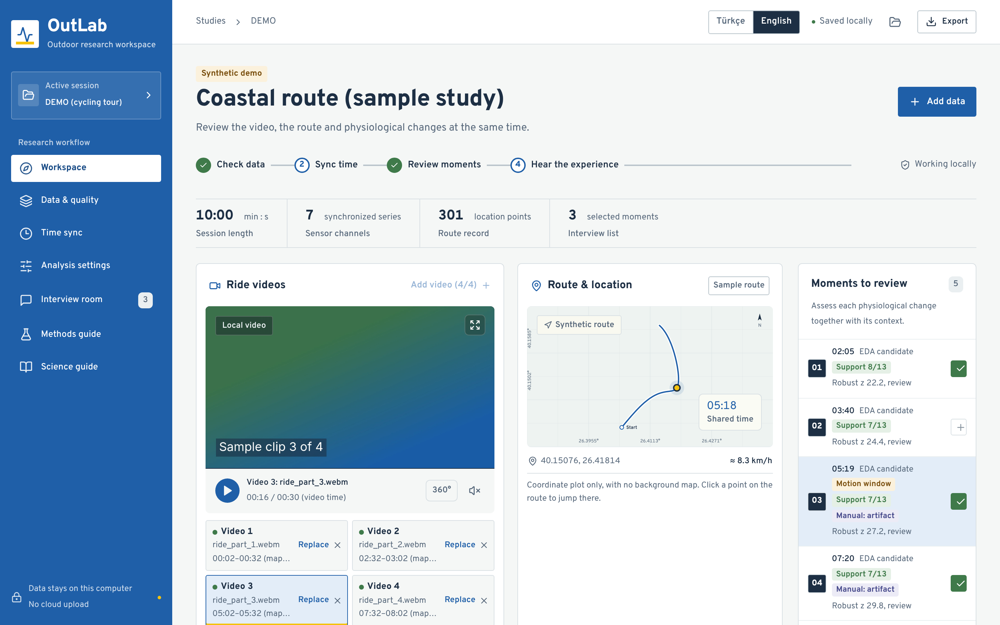

<sub>Screenshots show the built-in synthetic demo session and generated sample clips, not participant data.</sub>

## What it does

- **One clock for three recordings.** The EmotiBit clock is the reference axis. Each video gets its own mapping, `t_sensor = rate × t_video + offset`, from one or two shared events (for example three taps on the sensor that are visible in the video). The GPX route is checked separately. Click the chart, the route or the video, and all three jump to the same moment.
- **Up to four videos per session**, as consecutive parts of a ride or as simultaneous cameras. 4 × 60 min Full HD files work, because videos play from disk and are never uploaded or copied. Playback continues from one part into the next.
- **Transparent EDA analysis.** NeuroKit2 cleaning and a tonic/phasic split run per gap-free segment. A robust-z screen then finds candidate moments relative to a reference interval you choose. Raw data are never modified, and every parameter and library version is recorded.
- **Optional artifact and reliability methods**, switched off by default and run in addition to the core analysis:
  - EDA quality rules after Kleckner et al. (2018), with a usable-data percentage
  - window-based motion screening from the accelerometer and gyroscope, with GPS speed as context
  - multi-method robustness: 3 decompositions × 5 SCR peak methods, so each candidate shows how many combinations support it
  - manual artifact labels drawn while watching the video, with Cohen's kappa between coders and each automatic method checked against them
  - export in Ledalab's text format, to run CDA/DDA in Ledalab itself
- **Interview room.** A neutral participant view hides graphs and candidate reasons and asks an open question. The participant's own account is recorded separately from researcher codes.
- **Methods guide.** Each method is documented in the app: what it does, how it is computed, its limitations, a model reporting paragraph and the sources behind it.
- **Reproducible output.** The portable project package is checked with SHA-256. You can also export processed EDA and interview CSVs, a printable method report and the Ledalab TXT file.

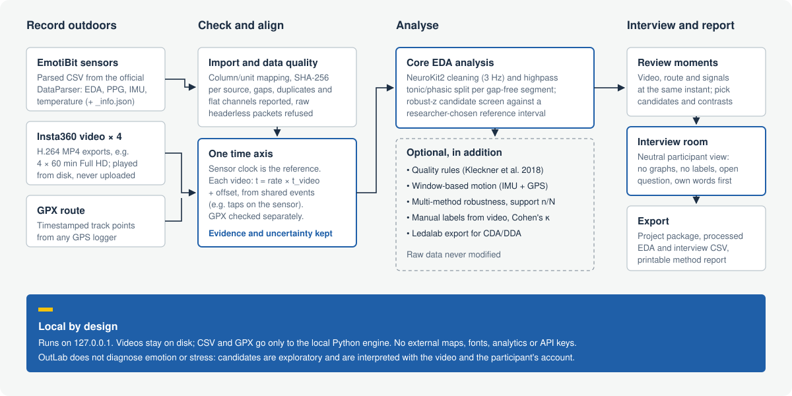

## A closer look

### Synchronized signals with optional checks

The chart shades quality-rule failures, high-motion windows and manual labels. A trail-yellow marker shows the same moment in the chart, on the route and in the video.

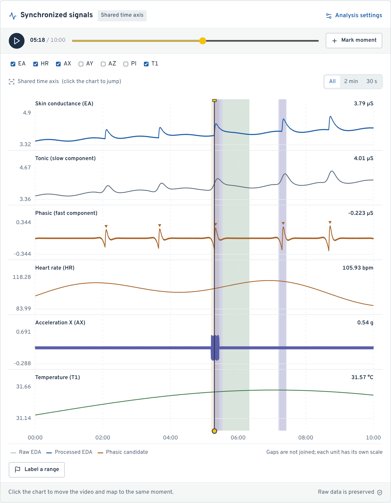

### Time sync, one mapping per video

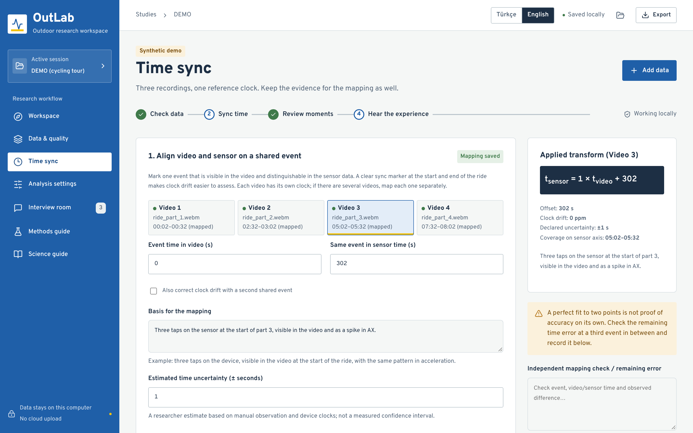

### Optional methods, chosen per analysis

<table>
<tr>
<td width="50%">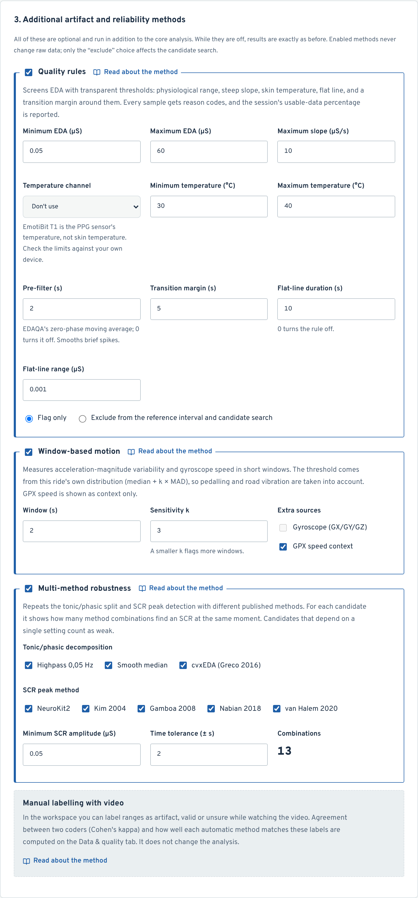</td>
<td width="50%">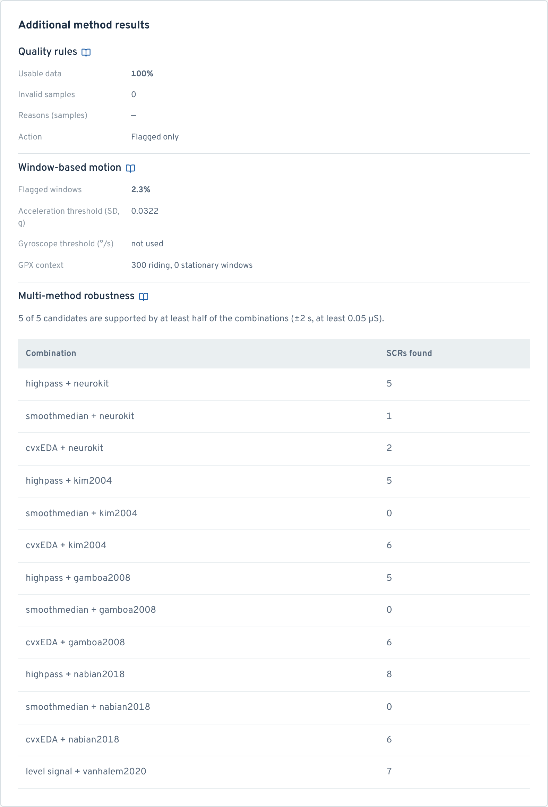</td>
</tr>
</table>

### Manual labels and agreement

Two coders label ranges while watching the video, and a blind mode hides the other coder's labels and the automatic marks. OutLab reports Cohen's kappa over 1-second bins, plus the sensitivity and specificity of each automatic method against a coder.

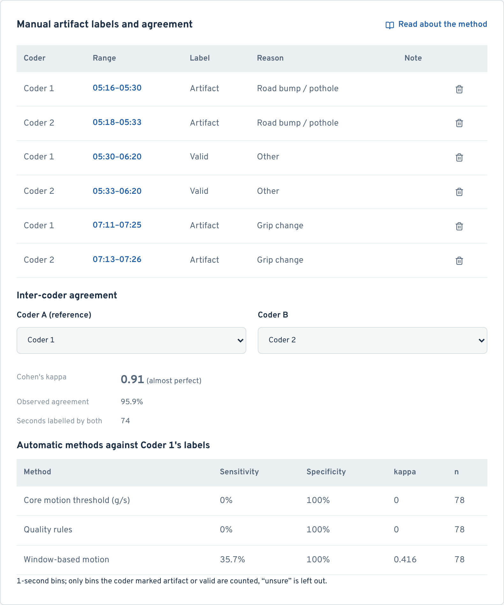

### Methods guide and participant view

<table>
<tr>
<td width="50%">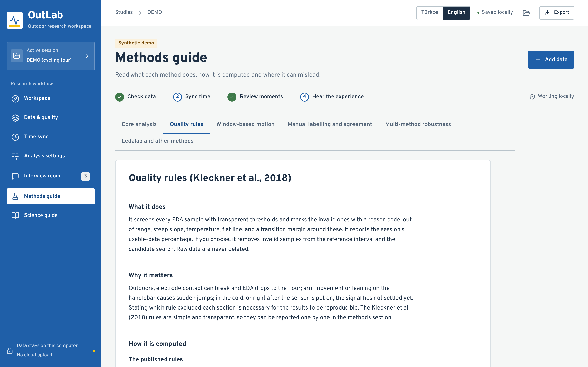</td>
<td width="50%">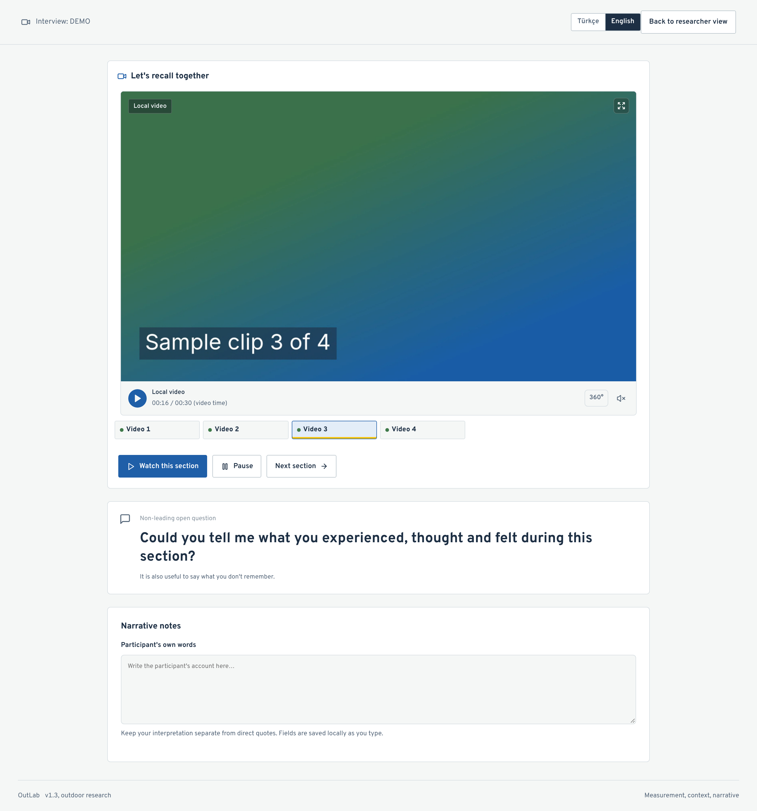</td>
</tr>
</table>

### Turkish interface and phone layout

<table>
<tr>
<td width="62%">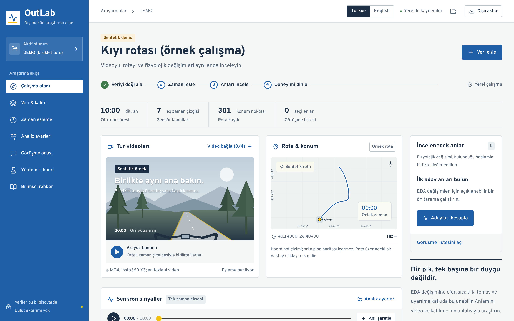</td>
<td width="38%">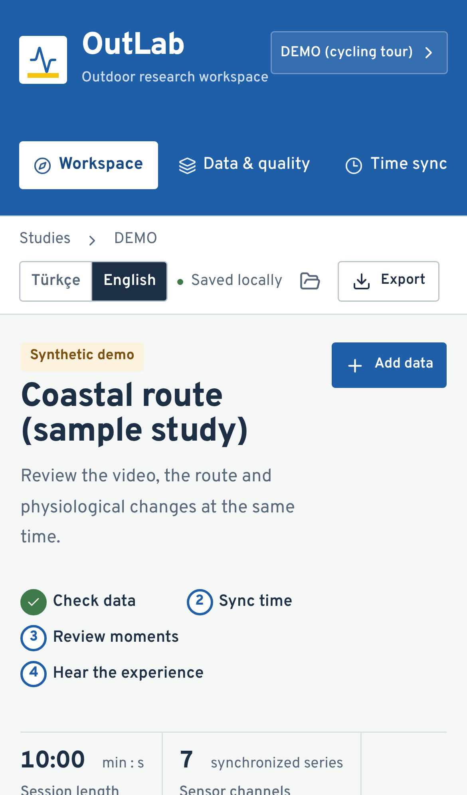</td>
</tr>
</table>

## Getting started

The easiest way is the [download](#download) above. To run from source instead, on **macOS** double-click `OutLab_Baslat.command`, then open **http://127.0.0.1:8765**. Keep the terminal window open while you work.

- **First launch** needs Python 3.11+ and Node.js 22+. It downloads free, open-source packages; no API key or paid service is needed. After that, analysis and the route view work offline.
- **cvxEDA** depends on the optional `cvxopt` package, which is GPL-3.0. The launcher installs it only when a prebuilt wheel exists (for example on macOS 15 and later). Without it, cvxEDA is skipped and everything else works.

First steps:
1. Open the synthetic demo, run **Compute candidates** and add a few moments to the interview list.
2. Start a **new session** from the session menu and give the participant a research code.
3. **Add data:** drop the parsed EmotiBit CSVs and the `_info.json`, then up to four MP4 files and a timestamped GPX file.
4. On **Time sync**, map each video and verify the GPX offset, recording the basis and the uncertainty.
5. Under **Analysis settings**, choose a reference interval of good quality and known context, switch on optional methods if you want them, and run the analysis.
6. Review candidates against the video, motion and the route. Mark low-response comparison moments by hand as well.
7. In the **Interview room**, set the time before and after each moment and switch to the participant view.
8. **Export** a portable project package as a backup. Store the videos separately; reconnecting the same file restores its mapping.

### Data requirements

- **EmotiBit:** OutLab expects CSVs parsed by the official **EmotiBit DataParser**. Raw headerless SD-card files are recognized and refused, with guidance, because packet times are not per-sample times.
- **Insta360:** export INSV recordings from Insta360 Studio as **H.264 MP4**. A stitched 2:1 equirectangular MP4 can be viewed in 360°.

## Research boundaries

OutLab does **not** diagnose emotion or stress. Candidate thresholds are exploratory researcher settings, not a validated SCR criterion or clinical cut-off, and the tonic/phasic split is a method-dependent estimate. HR or HRV are never derived from raw PPG.

Software tests do not establish the scientific validity of measurements taken while cycling:
- Independent studies have reported limited agreement between EmotiBit EDA and reference devices; see the sources in the Science guide.
- The quality thresholds come from other devices and settings.

Plan a field pilot and review the method with a supervisor. An end-to-end field validation with a real Insta360 X3 recording has not been done yet.

## Privacy

- The server listens only on `127.0.0.1`. Videos play as local files in the browser. CSV and GPX text goes only to the local Python engine.
- There are no external maps, analysis APIs, web fonts or telemetry. Overpass is bundled under the OFL.
- Sessions live in the browser's IndexedDB, so clearing site data removes them. The project package is not encrypted, and SHA-256 is an integrity check, not a signature.
- The repository contains application code and synthetic tests only. Real biometric CSV, GPX, video and session backups are excluded, and `.gitignore` adds a second layer of protection.

## Documentation

| Document | Contents |
|---|---|
| [User guide (TR)](docs/KULLANIM_KILAVUZU.md) | Step-by-step use, limits, troubleshooting |
| [Scientific basis (TR)](docs/SCIENTIFIC_BASIS.md) | Method decisions and pilot protocol |
| [Sources](docs/SOURCES.json) | 32 sources with verification notes (also shown in the app) |
| [Source verification log](docs/SOURCE_VERIFICATION_2026-11.md) | How each source was checked and what remains unconfirmed |
| [Validation log (TR)](docs/VALIDATION.md) | Test results per version |
| [API contract](docs/CONTRACT.md) | Request and response shapes |
| [Requirements (TR)](docs/REQUIREMENTS.md) | Requirement mapping and limits |

## Development

```sh
python3 -m venv .venv
.venv/bin/python -m pip install -r requirements.lock.txt
.venv/bin/python -m pip install --only-binary=:all: -r requirements-optional.txt   # optional cvxEDA
npm ci
npm run build
.venv/bin/python -m uvicorn backend.main:app --host 127.0.0.1 --port 8765 --no-access-log
```

For development, run `npm run dev` (127.0.0.1:5173, proxied to the local API) in a second terminal. Tests:

```sh
.venv/bin/python -m pytest -q tests/test_backend.py   # 57 backend tests
npm run test:e2e                                      # 19 browser, geometry and agreement tests
```

Desktop packages are built by `.github/workflows/desktop.yml` with PyInstaller (`desktop/outlab.spec`, Inno Setup for Windows). Push a tag such as `v1.4.0`, or run the workflow by hand, and the macOS disk images and the Windows installer are built, self-tested and attached to a GitHub release.

The stack is React 19, TypeScript and Vite on the front end, with FastAPI, NeuroKit2, NumPy and SciPy behind it. `requirements.lock.txt` was verified on Python 3.13 and macOS arm64; check dependency compatibility separately on other platforms.

OutLab was previously called **RotaLab**. Sessions saved under that name still open, and older `.rotalab.json` packages and single-video sessions are migrated automatically.

## License and author

OutLab is released under the [MIT License](LICENSE) and is free to use. It needs no account, subscription or API key, and it makes no network requests apart from the local engine on your own computer.

It is built on open-source components that keep their own permissive licenses (MIT, BSD, Apache-2.0, PSF, ISC, MPL-2.0, and OFL-1.1 for the Overpass typeface). They are listed in [THIRD_PARTY_NOTICES.md](THIRD_PARTY_NOTICES.md), with the full texts in [THIRD_PARTY_LICENSES.txt](THIRD_PARTY_LICENSES.txt), and both files ship inside the desktop apps. The optional `cvxopt` package (GPL-3.0) is not distributed with OutLab.

OutLab is a research tool, **not a medical device**, and is provided "as is" without warranty (see the license). EmotiBit, Insta360, Ledalab, LinkedIn, GitHub and X are trademarks of their respective owners; OutLab is an independent project and is not affiliated with or endorsed by them.

Developed by **Alparslan Güvenç**: [LinkedIn](https://www.linkedin.com/in/alparslanguvenc) · [GitHub](https://github.com/alparslanguvenc) · [X](https://x.com/AlparslanGvnc)

---

## Türkçe

**OutLab**, dış mekânda yapılan biyometrik ölçümler için yerel bir araştırma çalışma alanıdır. EmotiBit sensör verisi, en fazla dört Insta360 videosu ve GPX rotası tek bir zaman çizgisinde birleşir. Seçilen anlar uyarılmış hatırlama görüşmesinde kullanılır. Arayüz Türkçe ve İngilizcedir; üst çubuktaki **Türkçe / English** seçicisiyle dil değişir.

- **İndirme:** Hazır uygulamalar yukarıdaki [Download](#download) bölümünde: macOS için `.dmg`, Windows için `.exe` kurulum dosyası. Python veya Node.js gerekmez. macOS ilk açılışta uygulamayı engellerse **Sistem Ayarları → Gizlilik ve Güvenlik → Yine de Aç**'ı kullanın.
- **Kaynaktan açılış:** macOS'ta `OutLab_Baslat.command` dosyasına çift tıklayın ve **http://127.0.0.1:8765** adresini açın.
- **Veri:** EmotiBit verisi resmî DataParser ile ayrıştırılmış CSV olmalıdır. Videolar Insta360 Studio'dan H.264 MP4 olarak dışa aktarılmalıdır.
- **Ek yöntemler:** Kalite kuralları, pencere tabanlı hareket, çoklu yöntem sağlamlığı, videoyla elle etiketleme (Cohen's kappa) ve Ledalab dışa aktarma isteğe bağlıdır. Temel analize ek olarak çalışırlar ve ayrıntıları uygulamadaki **Yöntem rehberi** sekmesindedir.
- **Sınırlar:** OutLab duygu veya stres teşhisi yapmaz. Adaylar keşif amaçlıdır ve video ile katılımcının anlatımıyla yorumlanır. Saha pilotu ve danışmanla yöntem değerlendirmesi gerekir.

OutLab [MIT lisansı](LICENSE) ile ücretsiz yayımlanır ve Alparslan Güvenç tarafından geliştirilmiştir. Hesap, abonelik veya API anahtarı gerektirmez. Bir araştırma aracıdır, tıbbi cihaz değildir. Kullanılan açık kaynak bileşenlerin lisansları [THIRD_PARTY_NOTICES.md](THIRD_PARTY_NOTICES.md) dosyasındadır.

Ayrıntılı Türkçe belgeler: [Kullanım kılavuzu](docs/KULLANIM_KILAVUZU.md), [Bilimsel gerekçeler](docs/SCIENTIFIC_BASIS.md), [Doğrulama kaydı](docs/VALIDATION.md).
